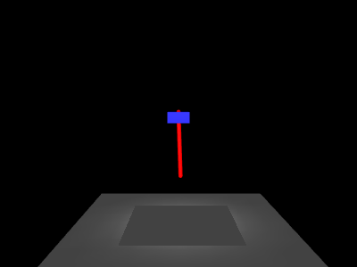

# Inverted Pendulum (MuJoCo + RL)

> Module 01 of [physical-ai-stack](../README.md). Run the commands below from this folder.

Cart-pole **swing-up**: the pole starts hanging down and must be swung up and balanced by pushing the cart.
Custom Gymnasium + MuJoCo environment, trained with Stable-Baselines3.



*SAC policy on a hard episode (hinge damping 0.019): pumps for about 12 s, catches the pole, holds it to the end.*

**Result:** SAC swings up and balances to the end of the episode in **98% of solvable episodes** (294/300).
PPO got 0-1%. Swing-up is physically impossible above hinge damping of about 0.02 with the 10 N motor, so the
environment now samples damping only inside the solvable range (see [Feasibility](#feasibility)).

## Files
| File | What |
|---|---|
| `balance_env.py` | `BalanceBotEnv`: MuJoCo model (slider cart + hinge pole), 5-value obs, shaped reward, domain randomization |
| `train_sac.py` | SAC training: `python3 train_sac.py 300000 --seed 1 --name sac_run` |
| `train.py` | PPO training (3M steps), saves `mujoco_balance_bot.zip` |
| `eval.py` | headless eval: `python3 eval.py mujoco_sac_feasible sac 300` |
| `watch.py` | MuJoCo viewer: `python3 watch.py mujoco_sac_feasible sac` |
| `feasibility.py` | searches for a swing-up trajectory at a given damping / force / track length |
| `make_gif.py` | renders a policy rollout to a GIF headlessly (EGL) |
| `hello_mujoco.py` | first MuJoCo experiment (sliding box) |
| `mujoco_sac_feasible.zip` | **best policy**: SAC, 300k steps, trained on the solvable damping range |
| `mujoco_sac.zip` | SAC, 300k steps, trained on the original wide damping range |
| `mujoco_balance_bot.zip`, `..._1p5M_backup.zip` | PPO policies (3M and 1.5M steps) |

## Environment
- Obs: `cart_pos, sin(angle), cos(angle), cart_vel, pole_vel` (angle 0 = upright, pi = hanging)
- Action: cart force in [-1, 1], scaled x10 (`ctrlrange="-10 10"`)
- 25 Hz control (4 physics steps of 0.01 s per action), 500-step episodes (20 s), cart limit +-3 m (hitting it ends the episode with -10)
- Reset: pole hanging (pi) plus small noise; pole mass x U(0.7, 1.3) and **hinge damping U(0.001, 0.02)** are randomized every episode
  (`BalanceBotEnv(damping_range=...)`; the original range was U(0.001, 0.05))
- Reward: `0.3*broad + narrow - 0.01*a^2 - 0.02*x^2`
  - `broad = (cos(angle)+1)/2`: weak slope everywhere, guides the swing
  - `narrow = exp(-(err/0.1)^2) * exp(-(pole_vel/4)^2)`: spike only when near upright AND slow, so flying through the top scores little

## Usage
```bash
python3 -m pip install -r requirements.txt
python3 train_sac.py 300000 --seed 1      # tensorboard --logdir ./sac_tensorboard/
python3 eval.py mujoco_sac_feasible sac 300
python3 watch.py mujoco_sac_feasible sac
python3 feasibility.py                    # ~80 s
python3 make_gif.py mujoco_sac_feasible 12 docs/swingup.gif
```

## Results
Deterministic policy, seeds 0-299, `python3 eval.py <policy> <ppo|sac> 300 [damping_max]`.
"Balanced" = last 50 steps of the 500-step episode all within 0.2 rad of upright.

| Policy | Trained on damping | Solvable range U(0.001, 0.02) | Original range U(0.001, 0.05) |
|---|---|---|---|
| PPO, 3M steps | wide | 1/300 (0%) | 3/300 (1%) |
| SAC, 300k steps (`mujoco_sac`) | wide | 279/300 (93%) | 99/300 (33%) |
| SAC, 300k steps, seed 0 (not committed) | solvable | 291/300 (97%) | 105/300 (35%) |
| **SAC, 300k steps, seed 1 (`mujoco_sac_feasible`)** | solvable | **294/300 (98%)** | 109/300 (36%) |

`mujoco_sac_feasible` by sampled hinge damping (solvable range):

| Damping | Balanced |
|---|---|
| 0.000-0.005 | 53/53 |
| 0.005-0.010 | 73/73 |
| 0.010-0.015 | 97/97 |
| 0.015-0.020 | 71/77 (92%) |

On the wide range the same policy gets 7/27 for damping 0.020-0.025 and 0/170 above 0.025.
Each SAC run took about 25-35 minutes on CPU (two runs in parallel, 4 threads each).

## Why SAC worked where PPO didn't
- **Entropy bonus:** SAC maximizes `reward + alpha * entropy`, with alpha auto-tuned toward a target entropy. It keeps exploring
  among actions of similar value instead of settling into a habit like "jiggle near the bottom". SB3's PPO default is `ent_coef=0`,
  so its randomness only decays.
- **Replay buffer:** rare lucky swing-ups are replayed thousands of times. PPO uses each sample once.
- **Two critics + target networks:** `min(Q1, Q2)` limits overestimation; slowly-updated targets keep learning stable.
- Cost: one gradient update per env step, so about 100-200 steps/s on CPU against PPO's ~2,400, but far fewer steps needed.

## Feasibility
The first SAC policy balanced only 33% of episodes, and 191 of the 201 failures had hinge damping above 0.02. Instead of training longer,
`feasibility.py` checks whether those episodes can be solved at all: a cross-entropy search over open-loop cart forces
(125 knots, 20 s, +-3 m, 10 N) for the highest point the pole reaches. `max cos(phi) = +1` means upright.

| Hinge damping | Best max cos(phi) found | Upright reached |
|---|---|---|
| 0.005 | +1.000 | yes |
| 0.020 | +1.000 | yes |
| 0.022 | +0.51 | no |
| 0.025 | +0.27 | no |
| 0.030 | +0.04 | no |
| 0.040 | -0.21 | no |
| 0.050 | -0.39 | no |

**Motor force is the binding constraint.** At damping 0.04: a 10 m track gives -0.20 and 40 s gives -0.21 (no help),
but 20 N reaches upright (+1.000). At 0.05, 20 N alone is not enough (+0.25). This matches the energy balance: to beat
damping `c` the cart must supply `m*lc*a*w >= c*w^2`, which at c = 0.05 is more than half of the cart's maximum acceleration.

The sharp cutoff near 0.02 is where the learned policy also stops working, so SAC was already solving nearly all solvable
episodes; 60% of the training episodes were impossible. That is why the range was restricted. A search is not a proof of
impossibility, but it agrees with the physics estimate and with the policy.

## Limitations
- 6 of 77 episodes with damping 0.015-0.020 still fail: that is the thin-margin edge of what the motor can do.
- It uses a lot of the track: max |x| per episode over 300 seeds has median 1.25 m, 90th percentile 1.49 m, max 2.03 m
  (of +-3 m; no episode hit the limit). The position penalty is weak.
- Mass randomization changes `body_mass` but not `body_inertia`.
- Only two training seeds; the committed policy is the better one (98% vs 97%).

## Debugging history
1. Pole cylinder was centred on its hinge: it started 15 cm inside the floor (huge contact forces) and its centre of mass sat on
   the hinge, so gravity gave no tipping torque. Fixed with a capsule from the hinge upward, collisions off.
2. Switching to swing-up left the old `abs(angle) > 0.4` termination, ending every episode at step 1. Removed.
3. `ctrlrange` clipped force to 1 N while the code scaled by 10. Fixed.
4. Negative reward made driving off the track cheaper than staying alive. Reward shifted to non-negative.
5. PPO jiggled near the bottom (flat reward there): added the narrow upright bonus, gated on low pole velocity.
6. PPO still only flew through the top (3/300 balanced). Switched to SAC: 99/300.
7. Remaining failures traced to hinge damping, randomized per episode. Trajectory search showed damping above ~0.02 is
   unsolvable with a 10 N motor. Restricted the range and retrained: 294/300.

## Next
- Stronger motor (20 N makes damping up to about 0.04 solvable) and retrain.
- Penalize cart drift more, so the policy balances near the middle of the track.
- Train longer or add reset-state diversity to polish the 0.015-0.020 damping band.
- Scale `body_inertia` together with `body_mass` when randomizing.
