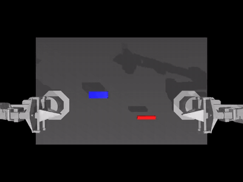
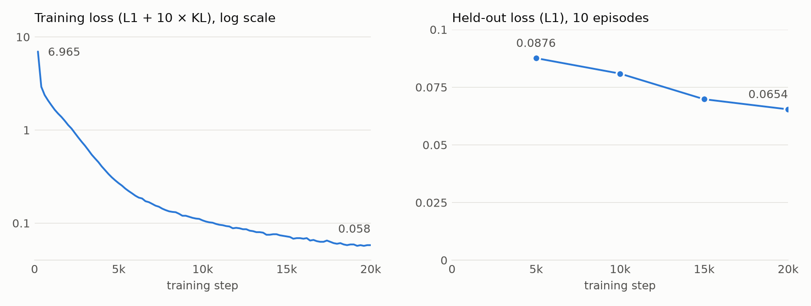

# 03: Vision-language-action

**Status: in progress.** An ACT policy is trained and evaluated in simulation with LeRobot. The language-conditioned part, a VLA proper, is not started.



*Evaluation episode 0, a success: the two arms pick up the peg (blue) and the socket (red) and insert the peg into the socket. 6.5 s of simulated time, shown at real speed.*

## ACT on ALOHA sim insertion

ACT, Action Chunking with Transformers, is an imitation-learning policy. It reads a camera frame and the robot's joint state and predicts the next 100 actions in one go instead of one at a time. Here it drives a simulated two-arm ALOHA robot through the insertion task, learning from demonstrations alone: no reward signal, no text.

| | |
|---|---|
| Dataset | `lerobot/aloha_sim_insertion_scripted`: 50 demonstrations from a scripted policy, 20,000 frames at 50 fps. Input: one 480×640 top camera and a 14-value joint state. Output: 14 joint targets |
| Split | 40 episodes (16,000 frames) for training, 10 held out (`--dataset.eval_split=0.2`) |
| Model | 51.6M parameters: ResNet-18 vision backbone (ImageNet weights), 4-layer transformer encoder, 1-layer decoder, VAE latent of size 32, chunks of 100 actions. Everything except the backbone starts from scratch, so this is not a fine-tune of a pretrained policy |
| Training | 20,000 steps at batch size 8 (10 passes over the training frames), AdamW at 1e-5, seed 1000, one RTX 4070 Laptop GPU, 47 minutes |
| Evaluation | 10 episodes in gym-aloha `AlohaInsertion-v0` with the step-20,000 checkpoint |

## Results



**Simulator evaluation: 5 of 10 episodes succeeded** (episodes 0, 4, 6, 8 and 9, max reward 4). The other five ended at max reward 3. The 95% interval for the success rate is 24% to 76%.

**Held-out loss** (L1 on the 10 demonstrations kept out of training): 0.0876 at 5k steps, 0.0809 at 10k, 0.0698 at 15k, 0.0654 at 20k. It fell at every checkpoint. The training loss adds a KL term with weight 10, and the held-out loss does not, because the VAE branch only runs in training mode. Compare the trends of the two curves, not their levels.

What the result does and doesn't say:

- Ten episodes is a small sample. An interval of 24% to 76% cannot separate a 30% policy from a 70% one. Read it as "completes the task about half the time", not as a measured rate.
- One run, one seed, no baseline. Longer training and a second seed are untried.
- The demonstrations come from a scripted policy, not from human teleoperation, and both training and evaluation are in simulation.
- ACT has no language input, so this is not yet a VLA. It covers the action-chunking half: images and state in, chunks of continuous actions out.

## Reproduce

LeRobot is not vendored here. Clone it into this folder, where `lerobot/` is git-ignored. This run used commit `781d3dac` (LeRobot 0.7.1, Python 3.12, PyTorch 2.15).

```bash
# run from this folder (03_vision_language_action/)
conda create -n vla python=3.12 -y && conda activate vla
git clone https://github.com/huggingface/lerobot.git && cd lerobot
git checkout 781d3dac
python -m pip install -e ".[dataset,wandb,training]"
python -m pip install -e ".[aloha]"      # gym-aloha, for the simulator evaluation

# Train: about 47 minutes on an RTX 4070 Laptop GPU. The dataset downloads on first use.
lerobot-train \
  --policy.type=act \
  --dataset.repo_id=lerobot/aloha_sim_insertion_scripted \
  --dataset.eval_split=0.2 \
  --batch_size=8 --eval_steps=5000 --save_freq=5000 --steps=20000 \
  --trackio.enable=true \
  --policy.push_to_hub=false --save_checkpoint_to_hub=false

# Evaluate in the simulator: about 45 seconds for 10 episodes.
lerobot-eval \
  --policy.path=outputs/train/<date>/<time>_act/checkpoints/020000/pretrained_model \
  --env.type=aloha --env.task=AlohaInsertion-v0 \
  --eval.n_episodes=10 --eval.batch_size=1
```

## Files

| Path | What |
|---|---|
| `act_aloha_insertion/train_config.json` | the full training config, as LeRobot wrote it |
| `act_aloha_insertion/policy_config.json` | the ACT policy config |
| `act_aloha_insertion/eval_info.json` | the simulator evaluation, per episode |
| `act_aloha_insertion/train_loss.csv`, `heldout_loss.csv` | the curves, parsed from the console log |
| `act_aloha_insertion/plot_training.py` | draws `training_curve.png` from the two CSVs |
| `act_aloha_insertion/videos/` | evaluation episode 0 (success) and episode 1 (ended at max reward 3) |

The trained weights are not in the repo: `model.safetensors` is 207 MB, over GitHub's 100 MB file limit. Training reproduces them in under an hour.

## Next

- A language-conditioned policy. This LeRobot commit ships VLA policies (`smolvla` and `pi0`, among others). Fine-tune one with LoRA adapters on a task that takes text commands.
- More evaluation episodes (50 or more) and a second seed, so the success rate gets an interval worth quoting.
