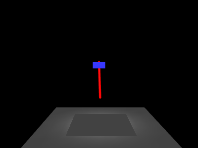

# physical-ai-stack

A bottom-up build of the physical AI stack: a physics simulator with a learned policy, GPU code for edge hardware, vision-language-action models, and learned world models. The thesis is that these belong in one pipeline, where sim-to-real reinforcement learning and bare-metal compute meet multimodal foundation models. Two of the four modules exist so far, in simulation and on one laptop GPU. The other two are placeholders and are marked as such.



*Module 01. A SAC policy on a hard episode (hinge damping 0.019) pumps the cart for about 12 s, catches the pole and holds it to the end.*

## Status

| Module | What | State |
|---|---|---|
| [01_sim_to_real_rl](01_sim_to_real_rl/) | MuJoCo cart-pole swing-up, PPO vs SAC, a reachability check | Done, simulation only |
| [02_bare_metal_compute](02_bare_metal_compute/) | CUDA kernels, unified memory, timing | One kernel and a timing breakdown |
| [03_vision_language_action](03_vision_language_action/) | VLA fine-tuning with LeRobot and LoRA | Planned, not started |
| [04_predictive_world_models](04_predictive_world_models/) | Learned dynamics, planning in latent space | Planned, not started |

## 01: Sim-to-real RL

The task is cart-pole swing-up. The pole starts hanging down, a 10 N motor pushes the cart along a ±3 m track, and the policy has 20 s to get the pole upright and keep it there. Pole mass and hinge damping are randomized every episode.

PPO and SAC were first trained on the same damping range and tested on the part of it that is physically solvable. SAC (300k steps) balanced 279 of 300 episodes. PPO (3M steps) balanced 1. SAC retrained on the solvable range alone reaches **294 of 300 (98%)**.

That range came out of a failure analysis. The first SAC policy balanced a third of its test episodes, and 191 of the 201 failures had hinge damping above 0.02. Rather than train longer, a trajectory search over open-loop force sequences checked whether such episodes could be won at all. It found no swing-up above a damping of about 0.02 with a 10 N motor. With 20 N, a damping of 0.04 becomes solvable too. The environment now samples damping inside what the motor can handle, and the [module README](01_sim_to_real_rl/README.md) has the numbers and the caveats.

An early bug: the pole was a cylinder centered on its hinge, so it started 15 cm inside the floor and its center of mass sat on the hinge, which meant gravity gave it no tipping torque.

Simulation only. Randomizing mass and damping is groundwork for a transfer to hardware, not evidence of one.

## 02: Bare-metal compute

`vector_add.cu` adds two arrays of a million floats with one thread per element (4096 blocks of 256 threads) in unified memory. It prints about 1.5 ms, and that is not the kernel. `vector_add_timing.cu` splits the time: cold arrays cost about 1.5 ms of page migration, and the kernel itself takes 10 µs (median of 15 runs, RTX 4070 Laptop GPU).

Nothing has run on an edge board yet. The aim is GPU code for high-frequency control loops, and vector add is the warm-up.

## 03 and 04

Both are planned, and each folder has a README with the intended scope.

- **03, vision-language-action:** camera frames and a text command go through a transformer and come out as continuous motor commands. LeRobot, VLA fine-tuning with LoRA, action chunking.
- **04, predictive world models:** a learned model that predicts future states in latent space, so the agent plans before it acts instead of calling MuJoCo.

## Run

```bash
# module 01: Python, MuJoCo, Stable-Baselines3
cd 01_sim_to_real_rl
python3 -m pip install -r requirements.txt
python3 eval.py mujoco_sac_feasible sac 300

# module 02: NVIDIA GPU and CUDA toolkit
cd 02_bare_metal_compute
nvcc -O2 -o vector_add_timing vector_add_timing.cu && ./vector_add_timing
```
